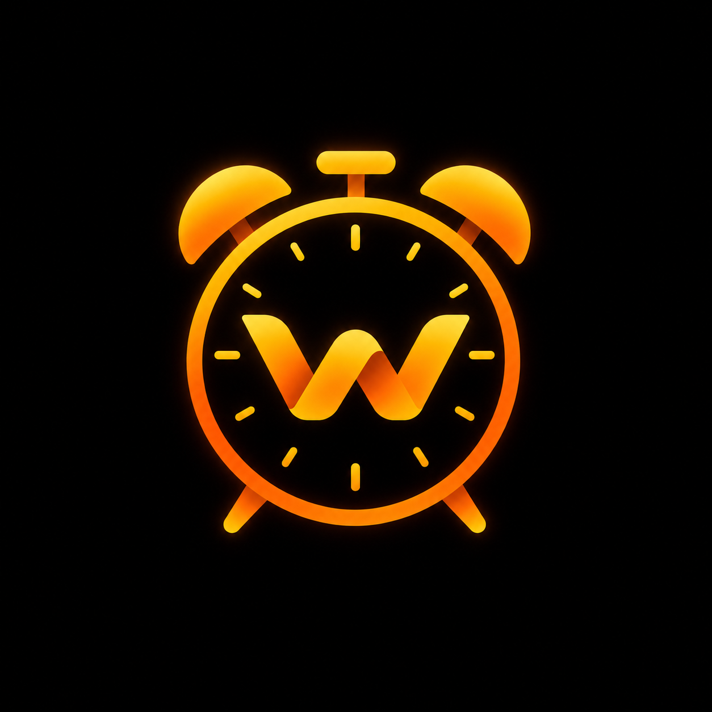
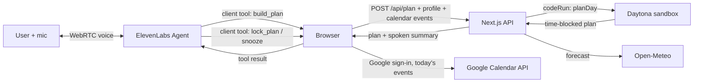

<p align="center"></p>

# Wake

**An AI wake-up coach that gets you out of bed, plans your day with you out loud, and locks the plan to your calendar.**

Built at the SDx SDSU Voice Agent Hackathon, November 8, 2026.

| | |
|---|---|
| **Track** | Open |
| **User** | A college student who sleeps through their 8 AMs |
| **Finish line** | They're out of bed with a time-blocked plan for today, locked and on their Google Calendar |

## What it does

1. **Set up once (about 60 seconds).** Name, wake time and days, connect Google Calendar, add this week's priorities, pick a coach voice and name it, and optionally paste in what ChatGPT or Claude already knows about you.
2. **The alarm rings.** Tap "I'm up" and your coach starts talking. It knows today's weather, your calendar and your priorities.
3. **It plans your day with you.** The coach calls a planning tool that runs our scheduler in a **Daytona sandbox** and reads the plan back in a sentence or two.
4. **Change your mind mid-call.** "Move gym to 6 and drop the club meeting." The coach re-runs the planner with every change so far and confirms what moved.
5. **Try to snooze.** It pushes back once, in character. Insist, and it really ends the call and re-arms the alarm (max 10 minutes, once per morning).
6. **"Lock it."** The plan is saved and shown with an **Add to Google Calendar** button on every block.

Works in **English and Spanish**.

## How it works



- **Voice:** an ElevenLabs Agent over WebRTC (WebSocket fallback). The browser starts the session with the user's briefing as dynamic variables and their chosen voice as a TTS override.
- **Tools:** three client tools, `build_plan`, `lock_plan` and `snooze`, run in the browser and call our API mid-conversation.
- **Planner in Daytona:** `web/src/lib/planner-core.ts` is a self-contained TypeScript scheduler. `/api/plan` ships the compiled `planDay` function into one long-lived, labeled Daytona sandbox and runs it there (about 1 second warm). Calendar events become fixed blocks, priorities fill the gaps, and the user's adjustments are applied cumulatively. If Daytona is unreachable, the same function runs locally so a call never dies.
- **Data:** each person's setup lives only in their own browser and is sent with each request. The server stores nothing, so two people on the same deployment never see each other's data.

## ElevenLabs features used

- **Conversational Agent** with a personality-driven system prompt and dynamic variables (name, coach name, personality, backstory, weather, calendar, tasks, language)
- **Client tools:** `build_plan`, `lock_plan`, `snooze`
- **Custom designed voice:** "Wake Signature", made with Voice Design for this app, plus 4 library presets (Hype, Sunny, Calm, Coach). The user picks one and names it, and it's applied per session as a TTS override
- **Knowledge base:** the Wake Morning Playbook (`agent/knowledge/morning-playbook.md`) for off-topic questions about sleep, energy and focus
- **Tuned turn-taking:** eager turns, speculative turn, backchannels like "mm-hmm" don't interrupt, a short filler while a tool runs, and the call ends after 25 seconds of silence
- **Two languages:** Spanish sessions override the agent language, greeting and TTS model (`eleven_flash_v2_5`)
- **Low-latency speech:** `eleven_flash_v2` voices and the realtime Scribe ASR

## Run it locally

```bash
cd web
npm install
cp .env.example .env.local   # then fill it in
npm run dev                  # http://localhost:3000 in Chrome
```

`web/.env.local`:

```
NEXT_PUBLIC_ELEVENLABS_AGENT_ID=   # your agent (see below)
DAYTONA_API_KEY=                   # optional: without it the planner runs locally
NEXT_PUBLIC_GOOGLE_CLIENT_ID=      # optional: enables "Connect Google Calendar"
```

**Your own copy of the agent:** `ELEVENLABS_API_KEY=sk_... node agent/clone-agent.mjs` creates the agent, its tools and its knowledge base in your ElevenLabs account and prints the ID. The full agent setup is in `agent/agent-config.json` and `agent/wake-agent.md`.

**Google Calendar:** create an OAuth client (Web application) with `http://localhost:3000` as an authorized JavaScript origin, enable the Google Calendar API and add yourself as a test user. Without it, the calendar step accepts a Google Calendar secret iCal link or uses a demo day.

## Repo map

| Path | What |
|---|---|
| `web/src/components/` | Onboarding, Home, Settings, alarm and conversation UI, client tools (`planTools.tsx`), Google connector |
| `web/src/lib/` | Planner (`planner-core.ts`, `plan.ts` + Daytona), briefing, weather, calendar (ICS parser), voices, profile |
| `web/src/app/api/` | `briefing`, `plan`, `plan/lock`, `weather`, `calendar`, `tasks`, `profile` |
| `agent/` | Agent config, prompt, knowledge base, clone script |
| `design-system/wake/` | Design system and onboarding spec |
| `ios/` | Native iOS alarm wrapper (AlarmKit), work in progress |

## What's next

- **Native iOS alarm with AlarmKit,** so Wake rings through silent mode on a locked phone and tapping it opens straight into the live coach. A starter wrapper is in `ios/`.
- **A morning phone call** through Twilio, as an option, for people who want Wake to call them.
- **Google verification,** so anyone can connect their calendar without being added as a test user.
- **Memory across mornings,** so the coach knows what you planned yesterday and whether you did it.

## Team

Built at SDx SDSU by RJ Galasieski with teammates samdcater, thorhans3n and ihatenate on GitHub.
